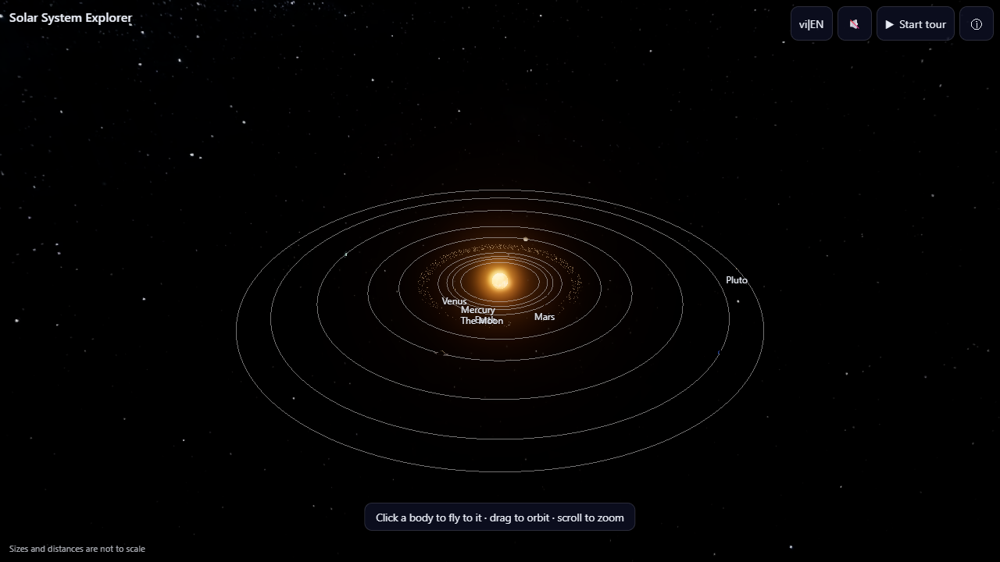
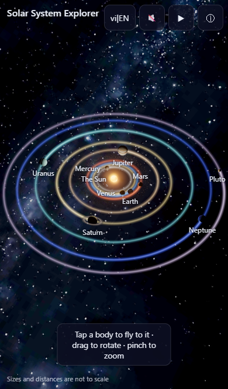
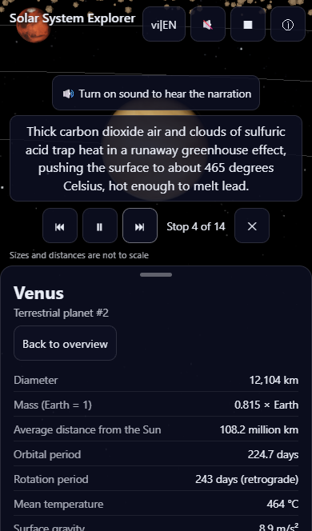

# Solar System Explorer

An interactive, bilingual (Vietnamese / English) 3D tour of the Solar System that runs in the browser and is designed mobile-first. Fly from the Sun to Pluto, tap any body for NASA-based facts, or sit back and let the narrated Tour Guide take you around.

**Live demo:** https://tuanluu-agilityio.github.io/solar-system/

|                      Desktop overview                      |                   Phone overview                   |                    Phone, tour stop                    |
| :--------------------------------------------------------: | :------------------------------------------------: | :----------------------------------------------------: |
|  |    |    |

## Features

- **Realistic, easy-to-read Solar System:** Sun with bloom, 8 planets, the Moon, Pluto and an instanced asteroid belt, with the Milky Way as background. Sizes and distances are compressed for readability (a "not to scale" note is always shown).
- **Fly-to inspection:** tap or click a body (or its label) and the camera flies to it. Orbit and zoom like a map; a tap that is really a drag never selects.
- **Info panel:** left panel on desktop, bottom sheet on phones, with NASA-based facts in Vietnamese and English.
- **Tour Guide:** 14 narrated stops (intro, 12 bodies, outro) with synchronised subtitles. It autostarts once on the first visit; any touch pauses it. Narration is generated with Microsoft Edge TTS (`vi-VN-HoaiMyNeural`, `en-US-AvaNeural`) and committed as mp3, so no network call is needed at runtime.
- **Sound:** procedural ambient sound and a fly-to whoosh built with the Web Audio API. Muted by default, starts only after a user gesture, and ducks under the narration.
- **Adaptive quality:** low / medium / high tiers; an FPS monitor steps down on real GPUs (never under software rendering) while keeping textures, sun light and bloom.
- **Bilingual UI:** language toggle, default language taken from the browser, choice remembered.

## Tech stack

TypeScript (strict), Vite, three.js, camera-controls, vanilla DOM UI (no framework), Vitest, Playwright, ESLint and Prettier. Textures are WebP, generated with sharp. Narration is generated with Python and `edge-tts`. CI and deployment run on GitHub Actions and GitHub Pages.

## Getting started

Requirements: Node 24 and npm 11. Python 3.14 is only needed to regenerate narration audio.

```bash
npm ci
npm run dev      # Vite dev server (default http://localhost:5173/)
```

Common scripts:

| Script                  | What it does                                                                                     |
| ----------------------- | ------------------------------------------------------------------------------------------------ |
| `npm run build`         | Typecheck and production build (set `BASE_PATH=/solar-system/` to mimic GitHub Pages)            |
| `npm run preview`       | Serve the production build                                                                       |
| `npm run lint`          | ESLint                                                                                           |
| `npm run typecheck`     | `tsc --noEmit`                                                                                   |
| `npm test`              | Unit tests (Vitest)                                                                              |
| `npm run test:e2e`      | End-to-end tests (Playwright, three device profiles). Slow under software GL; uses port 4173     |
| `npm run test:visual`   | Refreshes the screenshots in `docs/screenshots/`                                                 |
| `npm run test:perf`     | Headed real-GPU FPS measurement, writes `docs/perf-results.json`                                 |
| `npm run check:budget`  | Checks the load budgets after a build (JS at most 800 KB gzip, initial payload at most 8 MB)     |
| `npm run fetch:textures`| Re-downloads and converts the textures (needs network)                                           |
| `npm run narration`     | Regenerates changed narration mp3 files (needs the Python venv and network)                      |
| `node scripts/token-stats.mjs` | Token usage report from the local Claude Code transcripts                                 |

The generated assets (textures and narration) are committed, so building, testing and CI need no network.

## Project structure

```
src/
  config/       scale and time constants
  data/         body data, bilingual content, tour stops (see src/data/CLAUDE.md to add a body)
  scene/        renderer, sky, post-processing, textures, loop
  bodies/       sun, planets, Earth, rings, asteroid belt, orbits
  camera/       framing maths and the camera rig
  interaction/  tap-vs-drag picker
  tour/         tour state machine, narration, controller
  audio/        Web Audio engine, ambient, whoosh
  ui/           layout, labels, info panel, controls, subtitles
  quality/      quality tiers and FPS monitor
  i18n/, state/ strings, store and preferences
tests/          unit, e2e, visual and perf
scripts/        textures, narration, budget and token tools
docs/           specs, plan, progress logs, ADRs, reviews, screenshots
```

## Performance

Measured with `npm run check:budget` and `npm run test:perf` (details and caveats in `docs/decisions/0005-performance-results.md`):

- JS: about 183 KB gzip (budget 800 KB). Initial payload: about 3.6 MB (budget 8 MB).
- Emulated mid-range phone (Pixel 7, 4x CPU throttle) on a laptop iGPU: about 48 FPS in the overview and 55 FPS focused on Saturn (target 30).
- Desktop `high` tier on an Intel Arc iGPU: 42 to 54 FPS (target 55). The runtime monitor steps down to `medium` (about 56 FPS). Open item, see `docs/KNOWN_ISSUES.md`.
- Measuring on a real phone is still a manual step: see `docs/HUMAN_REVIEW.md`.

## How this project was built

The whole project, including this README, was produced by Claude Code agents from a written spec and plan, as a worked example of an AI-agent setup:

- Spec and plan: `docs/superpowers/specs/` (Vietnamese) and `docs/superpowers/plans/`.
- 32 planned tasks plus one added polish task (28b). Each task ran in its own git worktree and branch, was implemented by a subagent, reviewed by a second one, opened as a pull request and merged only after the `verify` CI job passed. History: one merge per PR, see `git log --first-parent main`.
- Model tiers were chosen per task to save tokens: Opus for design, hard tasks and the final review, Sonnet for normal tasks and reviews, Haiku for mechanical ones.
- `AGENTS.md` is the single source of truth for agents; `CLAUDE.md` imports it. Hooks, subagents and commands live in `.claude/`. A Vietnamese guide to the whole setup is in `docs/ai-setup.md`.
- Token usage of the whole run: `docs/TOKEN_USAGE.md`.

## Documentation

| File                                              | Content                                                      |
| ------------------------------------------------- | ------------------------------------------------------------ |
| `AGENTS.md`, `CLAUDE.md`, `src/data/CLAUDE.md`    | Rules, commands and conventions for AI agents                |
| `docs/FINAL_REVIEW.md`                            | Final review against the spec, with evidence                 |
| `docs/KNOWN_ISSUES.md`, `docs/BACKLOG.md`         | Open issues and future ideas                                 |
| `docs/decisions/`                                 | Architecture decision records                                |
| `docs/progress/`                                  | One progress log per task, with its decisions                |
| `docs/TOKEN_USAGE.md`                             | Token usage statistics                                       |
| `docs/ai-setup.md`, `docs/HUMAN_REVIEW.md`        | AI setup guide and human review checklist (Vietnamese)       |

## Credits and data

- Textures: [Solar System Scope](https://www.solarsystemscope.com/textures/) (CC BY 4.0). Pluto uses a generated placeholder texture.
- Facts and figures: NASA.
- Narration voice generated with Microsoft Edge TTS (personal, educational project).
- Analytics: production deploys use Google Analytics 4 for anonymous usage statistics (`ANALYTICS=1` or a Netlify production build, see `vite.config.ts`); dev, CI and previews send nothing.

## License

No license has been chosen yet. Add one before reusing or redistributing the code; the textures keep their own CC BY 4.0 terms.
